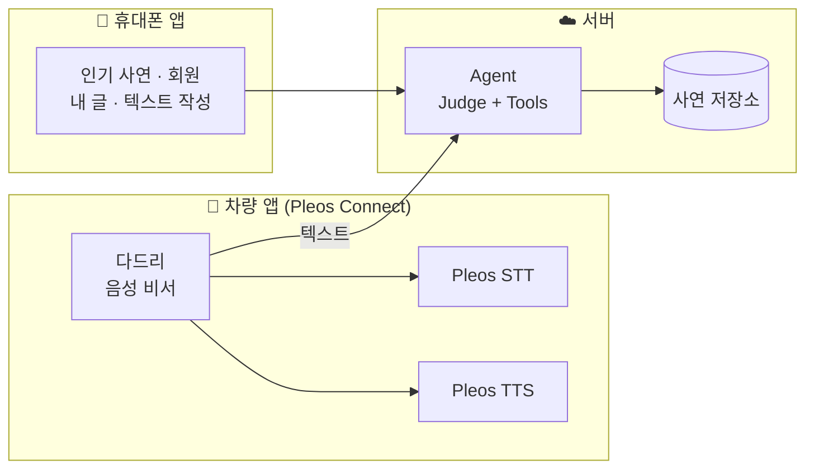
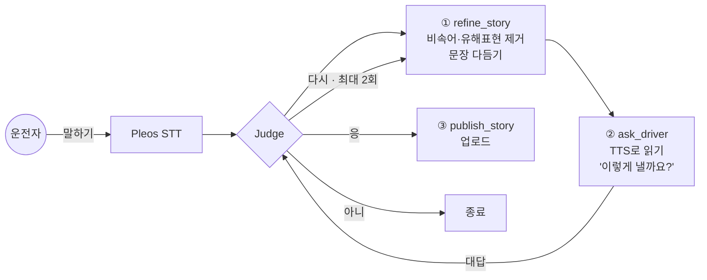

# 아워로드 (Our Road)

같은 길 위, 서로 모르는 사람들의 사연을 듣고 남기는 Pleos Connect 차량 앱.

> 현대자동차그룹 차량용 앱 개발 공모전 출품작

## 1. 문제 정의

**라디오에 사연을 보내던 경험에서 시작했습니다.**

아침 출근길, 나에게는 매일 지나는 삭막한 무채색 도로일 수 있습니다.
하지만 같은 도로가 어떤 가족에게는 힘겹게 시간을 내어 떠나는 여행의 출발길이기도 합니다.

같은 길을 지나는 사람들은 서로를 모른 채 각자의 이야기를 싣고 달립니다.
아워로드는 그 이야기를 라디오 사연처럼 듣고 남길 수 있게 합니다.
서로 모르는 사람들의 사연을 들으며 공감하고, 지금 우리에게 부족한 감성을 채웁니다.

## 2. 주요 기능

### 🚗 차량 앱 — 말만 하면 되는 비서 "다드리"

운전 중에는 화면 조작을 최소화하기 위해, 모든 기능을 **다 들어주는 비서 "다드리"** 에게 말로 요청합니다.

| 기능 | 설명 |
| --- | --- |
| 말로 사연 남기기 | 다드리에게 이야기하면 Agent가 문장을 정제하고 "이렇게 낼까요?"라고 읽어 준 뒤, 승인하면 사연을 올립니다 |
| 사연 듣기 | 다른 사람들이 남긴 사연을 라디오처럼 음성으로 듣습니다 |
| 주행 안전 | 주행 중에는 화면을 최소화하고 음성으로만 진행합니다. 시작·중단은 버튼으로도 할 수 있습니다 |

### 📱 휴대폰 앱

| 기능 | 설명 |
| --- | --- |
| 인기 사연 듣기 | 많은 사람이 공감한 사연을 모아 듣습니다 |
| 회원 | 회원가입 · 로그인 · 로그아웃 |
| 내가 쓴 글 | 내가 올린 사연을 확인합니다 |
| 텍스트로 사연 올리기 | 운전하지 않을 때 직접 글을 써서 올립니다 |

## 3. 시스템 구조



- 음성 인식은 **Pleos STT**로 차량 안에서 처리하고, 서버에는 **텍스트만** 보냅니다.
- 차량 앱과 휴대폰 앱은 같은 서버와 사연 저장소를 사용합니다.

## 4. 사연 올리기 Agent 구조



**Judge** 가 Tool 3개의 순서를 정하고, 운전자의 대답을 듣고 다음 행동을 판단합니다.

| Tool | 하는 일 |
| --- | --- |
| ① `refine_story` | STT로 받은 텍스트에서 비속어·유해 표현을 지우고, 문장을 조리 있게 다듬습니다 |
| ② `ask_driver` | 다듬은 사연을 TTS로 읽어 주고 "이렇게 낼까요?"라고 묻습니다 |
| ③ `publish_story` | 사연을 업로드합니다 |

| 운전자 대답 | Judge 판단 |
| --- | --- |
| "응" | ③ 업로드 |
| "다시" | ① 다시 정제 → ② 다시 묻기 (최대 2회) |
| "아니" · 2회 초과 | 올리지 않고 종료 |

## 사용한 Pleos SDK

| SDK | 버전 | 용도 |
| --- | --- | --- |
| SpeechToText | 3.3.1 | 다드리 음성 인식 (ON_DEVICE 모드) |
| TextToSpeech | 3.3.1 | 사연 확인 질문 · 사연 낭독 |
| Vehicle | [ ] | 주행 상태 |
| FusedLocation | [ ] 사용 여부 | |
| NaviHelper | [ ] 사용 여부 | |

LLM(Agent)은 Pleos LLM SDK가 제공되지 않아 서버에서 외부 API로 처리합니다. 서버 소스와 API 키는 이 저장소에 포함하지 않습니다.

## 테스트 환경

| 항목 | 값 |
| --- | --- |
| 에뮬레이터 | **Pleos Connect v2.1.0** (Android 14 / API 34, Automotive) |
| 화면 규격 | **2560 × 1440, 160 dpi, 가로** |
| 빌드 | Android Studio (JBR 21), Gradle Wrapper 9.6.0, AGP 9.4.1 |
| SDK | compileSdk 37 · minSdk 28 · targetSdk 34 |

## 실행 방법

### APK로 바로 실행

1. Pleos Connect v2.1.0 에뮬레이터를 켭니다.
2. 아래 명령으로 설치합니다.

```bash
adb install apk/[팀명]_아워로드_release.apk
```

3. 앱 목록에서 **아워로드**를 실행합니다.

### 소스에서 빌드

```bash
./gradlew :app:assembleDebug
```

```bash
adb install -r app/build/outputs/apk/debug/app-debug.apk
```

`local.properties`에 `sdk.dir`(Android SDK 경로)이 있어야 합니다. Android Studio로 열면 자동으로 만들어집니다.

### 주행 규제 시연

```bash
adb shell cmd hmg_car_service --service drivingstate driving_regulation on
```

```bash
adb shell cmd hmg_car_service --service drivingstate driving_regulation off
```

## APK 위치

`apk/[팀명]_아워로드_release.apk` [ ] release 빌드 후 추가

## 향후 계획

- 주행 중 마이크 입력 허용 범위는 운영사무국·현대자동차 확인 결과에 맞춰 적용합니다.
- [ ] 팀 추가 항목

## 저장소 구성

| 경로 | 내용 |
| --- | --- |
| `app/` | Kotlin 차량 앱 |
| `apk/` | 제출용 release APK |
| `docs/` | 기획 · Pleos 조사 · 주행 안전 · 검증 시나리오 |

## 팀원용 안내

1. 이 저장소를 clone하고 [온보딩](docs/onboarding.md)을 따른다.
2. [프로젝트 맥락](docs/project-context.md), [결정·미정 사항](docs/decisions.md)을 확인한다.
3. [작업 목록](tasks/README.md)에서 담당 범위를 정하고 작업별 브랜치 → 검증 → PR → 다른 팀원 리뷰로 공유한다.

| 파일 | 역할 |
| --- | --- |
| [AGENTS.md](AGENTS.md) / [CLAUDE.md](CLAUDE.md) | AI 공통 규칙과 Claude Code 진입점 |
| [개발 환경](docs/environment.md) / [협업 흐름](docs/workflow.md) | OS별 시작과 작업 공유 |
| [Pleos 조사](docs/pleos.md) / [공모전 조사](docs/competition.md) | 조사 스냅샷; 사용 전 공식 원문 재확인 |
| [Pleos 가이드](docs/pleos/README.md) | 요구사항 · 주행 안전 · 아키텍처 |
| [작업 목록](tasks/README.md) / [양식](templates/README.md) / [프롬프트](PROMPTS.md) | 작업·API 계약·검증·인수인계 |

문서 검사(Python 3.9+, 외부 패키지 없음):

```sh
python3 scripts/check_harness.py
```
