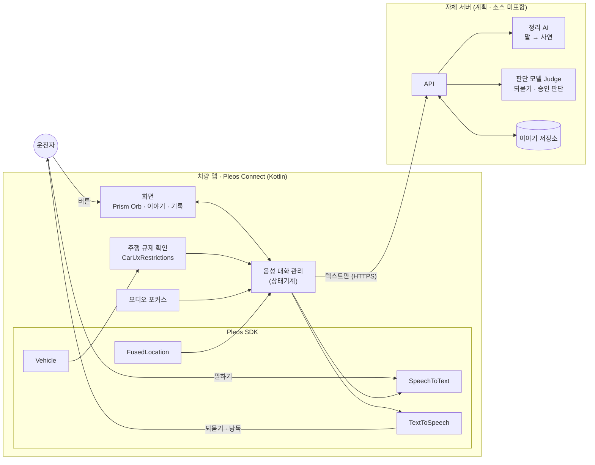
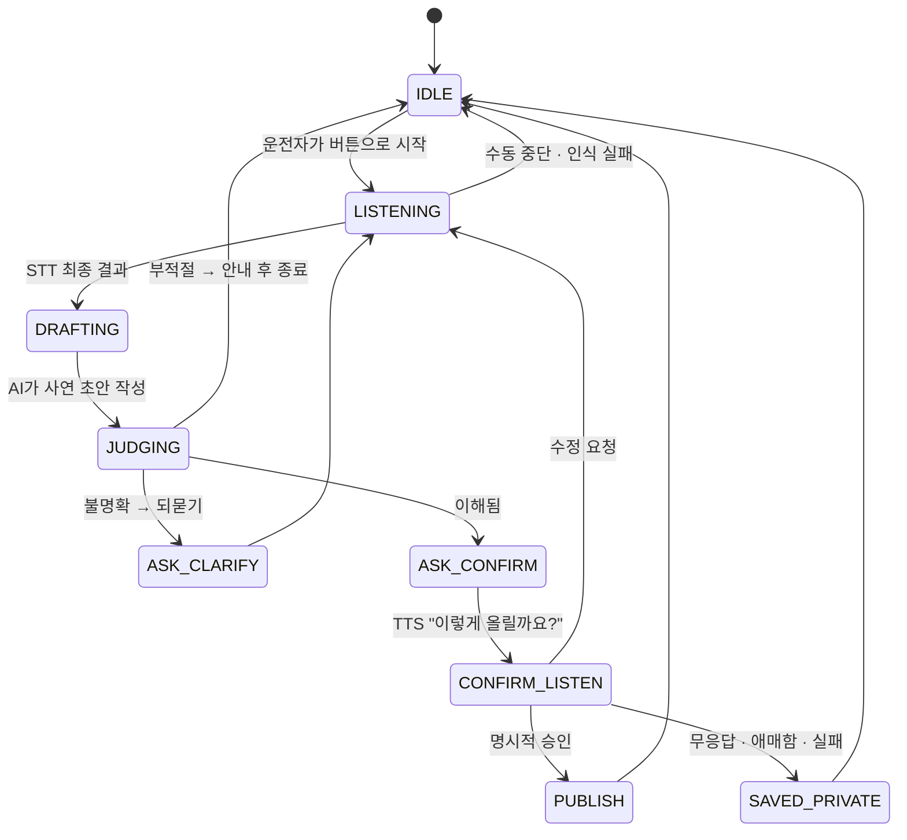

# ourroad · 같은 길, 다른 시간

> 현대자동차그룹 차량용 앱 개발 공모전 출품작 · 팀 핸들과그랬대 (handleandgratte)

## 앱 이름 및 한 줄 소개

**ourroad** — 서로 다른 시간에 같은 도로를 지나간 운전자들이, 말로 남긴 이야기로 이어지는 Pleos Connect 차량 앱입니다.

운전자가 라디오에 사연을 보내듯 말하면, 음성 에이전트 **다드리**가 받아 적고 다듬어서 "이렇게 올릴까요?"라고 되묻습니다. 운전자가 "응"이라고 답해야만 그 길 위에 이야기가 남습니다. 지금 지나는 구간에 남겨진 이야기는 음성으로 듣습니다.

## 이번 제출물의 범위

이번 APK는 **1차 기획 제출용 목업**입니다. 1차 단계에서는 Pleos SDK 사용이 열리지 않아, 아래처럼 동작합니다.

- Pleos SDK·차량 API·마이크·위치를 호출하지 않습니다. Manifest에 권한 선언이 없습니다.
- 다드리의 말과 사연은 모두 **예시 대사**입니다. 실제 사용자의 이야기가 아닙니다.
- 음성 인식·차량 상태(주차/주행, 정체, 동승자)·서버 판단 결과는 화면 오른쪽의 **시연 제어** 패널로 흉내 냅니다. 시연 제어는 발표용이며 실제 차량 화면에는 넣지 않습니다.
- 서버·로그인·네트워크 없이 단독으로 실행됩니다.

## 주요 기능

| 기능 | 설명 | 이번 APK |
| --- | --- | --- |
| 다드리 대화 화면 | 듣기·생각·말하기 상태를 빛(Prism Orb)과 상태 한 줄로 보여 주는 음성 중심 화면 | 구현 (예시 대사) |
| 길 위의 이야기 듣기 | 지금 지나는 구간에 남겨진 이야기를 음성으로 재생 | 예시 사연 낭독 흐름 |
| 말로 남기는 사연 | 받아 적기 → 다듬기 → "이렇게 올릴까요?" 확인 → 명시적 승인 시에만 게시 | 예시 대사로 시연 |
| 판단 결과 반영 | 정리본에서 이름 지움 · 그대로 · 되묻기 | 시연 제어에서 선택 |
| 주행 상태 대응 | 주행 중에는 화면을 줄이고 소리로만 안내 | 시연 제어의 주차/주행 전환으로 시연 |
| 대화 상태기계 | 무응답·애매한 대답·중단을 승인으로 보지 않는 순수 Kotlin 상태기계(`DadeuriFlow`) | 구현 · 단위 테스트 11개 |

## 실행 방법

### APK로 바로 실행

1. Android Studio의 Device Manager에서 **Pleos Connect v2.1.0** 에뮬레이터를 켭니다.
2. 저장소 루트에서 APK를 설치합니다.

   ```bash
   adb install apk/handleandgratte_ourroad_release.apk
   ```

   같은 패키지의 다른 서명 빌드(예: 디버그 빌드)가 이미 설치되어 있으면 먼저 지웁니다.

   ```bash
   adb uninstall io.github.hyundaimotorappcontest.unseen
   ```

3. 앱 목록에서 **ourroad**를 실행합니다.

### 시연 순서

1. 첫 화면은 "휴대폰 연결이 필요해요"입니다. 가운데 **연결 확인**을 누르면 다드리가 인사합니다.
2. 오른쪽 시연 제어에서 **시나리오 1 · 혼자 퇴근, 정체 구간**을 누릅니다.
3. 다드리가 먼저 말을 걸고 사연 듣기 → 회전 안내 후 이어 듣기 → 공감 → 사연 남기기 → 이름 지움 확인 → "응"으로 게시까지 진행됩니다. 아래쪽 따옴표 버튼은 운전자가 말로 대답하는 것을 대신합니다.
4. 시연 제어의 **주차 / 주행**, **동승자 있음**, **정체 중**, **음악 재생 중**, **이 길에 사연 없음**, **서버 판단 결과**를 바꾸면 다드리의 행동이 달라집니다. **처음부터 (연결 전)**으로 초기화합니다.

### 소스에서 빌드

저장소 루트를 Android Studio에서 열고 Gradle 동기화 후 `app`을 Pleos 에뮬레이터에 Run 하면 됩니다. 터미널에서는 아래 명령을 씁니다.

| 작업 | macOS / Linux | Windows PowerShell |
| --- | --- | --- |
| 디버그 빌드 | `./gradlew :app:assembleDebug` | `.\gradlew.bat :app:assembleDebug` |
| 단위 테스트 | `./gradlew :app:testDebugUnitTest` | `.\gradlew.bat :app:testDebugUnitTest` |
| release 빌드 | `./gradlew :app:assembleRelease` | `.\gradlew.bat :app:assembleRelease` |

```bash
adb install -r app/build/outputs/apk/debug/app-debug.apk
```

- Android Studio 밖에서 빌드할 때는 JDK의 `JAVA_HOME`과 Android SDK의 `ANDROID_HOME`(또는 `local.properties`의 `sdk.dir`)이 필요합니다. Android Studio로 열면 `local.properties`가 자동으로 만들어집니다.
- release 서명 키는 저장소에 넣지 않았습니다. 저장소 루트에 `keystore.properties`(`storeFile`, `storePassword`, `keyAlias`, `keyPassword`)가 있으면 release 빌드를 그 키로 서명하고, 없으면 서명되지 않은 release APK가 만들어집니다. 바로 설치해 보려면 위 APK나 디버그 빌드를 쓰면 됩니다.

## 테스트 환경 및 필요한 설정

| 항목 | 값 |
| --- | --- |
| 에뮬레이터 | **Pleos Connect v2.1.0** (Android 14 / API 34, Automotive, arm64-v8a, RAM 4096MB) |
| 화면 규격 | **2560 × 1440, 160 dpi, 가로** |
| 앱 SDK 기준 | compileSdk 37 · minSdk 28 · targetSdk 34 |
| 빌드 도구 | Gradle Wrapper 9.6.0, Android Gradle Plugin 9.4.1 (내장 Kotlin 2.2.10), Jetpack Compose BOM 2026.09.00 |
| JDK | Android Studio 내장 JBR 25 |
| 확인한 호스트 | macOS (Apple Silicon, arm64) |

필요한 설정:

- 별도 설정이 필요 없습니다. 권한 허용·로그인·서버 주소·API 키·네트워크 연결 없이 실행됩니다.
- 화면은 위 에뮬레이터 규격(2560 × 1440 가로) 기준으로 배치했습니다.

2026-11-15 확인 결과: 위 환경에서 `assembleRelease` 빌드, 단위 테스트 11개 통과, Pleos Connect v2.1.0 에뮬레이터에 release APK 설치·실행(크래시 없음)까지 확인했습니다. Windows 호스트 빌드와 실차 실행은 확인하지 않았습니다.

## APK 파일 위치

[`apk/handleandgratte_ourroad_release.apk`](apk/handleandgratte_ourroad_release.apk)

| 항목 | 값 |
| --- | --- |
| 패키지 | `io.github.hyundaimotorappcontest.unseen` |
| 버전 | 0.1.0 (versionCode 1) |
| 빌드 | release, 팀 자체 키로 서명 |
| 크기 | 약 27MB |

## 목표 시스템 구조

아래는 SDK 사용이 열린 뒤의 목표 구조입니다. 이번 APK에는 자체 서버와 Pleos SDK 호출이 없고, 화면과 음성 대화 관리(`DadeuriFlow`)만 들어 있습니다.



| 구성 | 하는 일 |
| --- | --- |
| 화면 | 주행 중에는 최소 정보만 보여 주고, 정차 중에는 이야기 목록·기록을 보여 줍니다 |
| 음성 대화 관리 | 듣기 → 정리 → 판단 → 되묻기 → 게시 흐름을 관리합니다. SDK 없이 테스트할 수 있게 순수 Kotlin으로 분리했습니다 |
| 주행 규제 확인 | 규제 상태가 바뀌면 화면을 줄이고, 상태를 모르면 음성 세션을 멈춥니다 |
| Pleos SDK | 음성 인식·낭독·위치·차량 정보를 제공합니다 |
| 자체 서버 | STT 텍스트를 받아 사연으로 정리하고, 판단 모델이 결과를 구조화된 값(JSON)으로 돌려줍니다. API 키는 서버에만 둡니다 |

## 음성 사연 흐름



- 음성 인식은 **Pleos SpeechToText**로만 할 계획입니다. 차량 마이크 음성은 외부로 보내지 않고, 서버에는 STT가 만든 텍스트만 보냅니다.
- 무응답이나 애매한 대답은 승인으로 보지 않습니다. AI가 혼자 게시하지 않습니다.
- 시작·중단은 언제든 버튼으로도 할 수 있습니다. 내비게이션 안내나 통화가 오면 낭독을 멈췄다가 이어서 묻습니다.

계층별 설계 원칙: [docs/pleos/architecture.md](docs/pleos/architecture.md) · 음성 기획 상세: [docs/ourroad-voice.md](docs/ourroad-voice.md)

## 사용 예정 Pleos SDK

이번 APK에는 포함하지 않았습니다. 사용이 열리면 공식 문서에서 버전·권한·지원 상태를 다시 확인하고 연결합니다.

| SDK | 문서상 버전 | 용도 |
| --- | --- | --- |
| SpeechToText | 3.3.1 | 사연·확인 답변 음성 인식 (ON_DEVICE 모드) |
| TextToSpeech | 3.3.1 | 되묻기·확인·이야기 낭독 |
| Vehicle | 미정 | 주행·주차 상태와 차량 정보 |
| FusedLocation | 1.1.3 (미정) | 현재 구간 판별 |
| NaviHelper | 사용 여부 미정 | 경로·안내 상태 연동 후보 |

LLM(정리·판단)은 Pleos LLM SDK가 제공되지 않아 자체 서버에서 외부 API로 처리할 계획입니다. 서버는 아직 이 저장소에 없습니다.

## 향후 계획

공식 문서에서 아직 확인되지 않은 아래 항목은 운영사무국·현대자동차 확인 결과에 맞춰 적용합니다.

- 주행 중 마이크 입력과 공개 전 음성 확인의 허용 범위
- 탑승 시 자동 시작 안내의 허용 여부
- Pleos SpeechToText·TextToSpeech 사용 승인 시점과 권한
- 실제 통과한 공통 도로 구간 기준의 이야기 매칭, 신고·숨김·삭제

## 저장소 구성

| 경로 | 내용 |
| --- | --- |
| `app/` | Kotlin·Jetpack Compose 차량 앱 (다드리 화면, 대화 상태기계, 시연 제어) |
| `apk/` | 제출용 release APK |
| `docs/` | 기획·Pleos 조사·주행 안전·검증 시나리오 |
| `docs/pleos/` | 아키텍처·요구사항·준수 매트릭스·SDK 참고 |
| `intent.md` | 제품 기획 |

## 팀원용 안내

1. 이 저장소를 clone하고 [온보딩](docs/onboarding.md)을 따른다.
2. [제품 기획](intent.md), [프로젝트 맥락](docs/project-context.md), [결정·미정 사항](docs/decisions.md)을 확인한다.
3. [작업 목록](tasks/README.md)에서 담당 범위를 정하고 작업별 브랜치 → 검증 → PR → 다른 팀원 리뷰로 공유한다.

| 파일 | 역할 |
| --- | --- |
| [AGENTS.md](AGENTS.md) / [CLAUDE.md](CLAUDE.md) | AI 공통 규칙과 Claude Code 진입점 |
| [개발 환경](docs/environment.md) / [협업 흐름](docs/workflow.md) | OS별 시작과 작업 공유 |
| [Pleos 조사](docs/pleos.md) / [공모전 조사](docs/competition.md) | 조사 스냅샷; 사용 전 공식 원문 재확인 |
| [ourroad 검증 시나리오](docs/verification-scenarios.md) | 동의·차량 상태·공유 구간·프라이버시·콘텐츠 검증 |
| [작업 목록](tasks/README.md) / [양식](templates/README.md) / [프롬프트](PROMPTS.md) | 작업·API 계약·검증·인수인계 |
| [이관 기록](docs/harness-migration.md) / [검증 결과](docs/validation.md) | 원본 출처·폐기 기준·확인 수준 |

문서 검사(Python 3.9+, 외부 패키지 없음):

```sh
python3 scripts/check_harness.py
```
