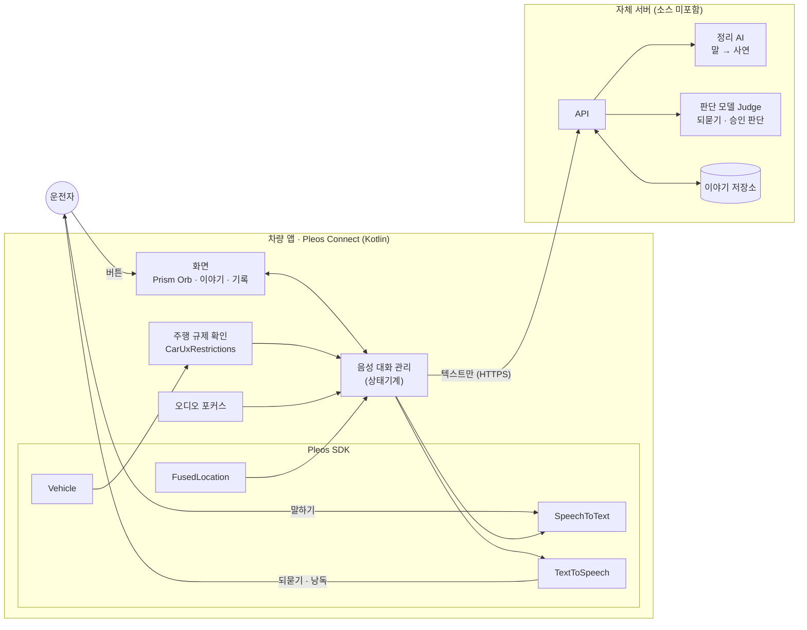
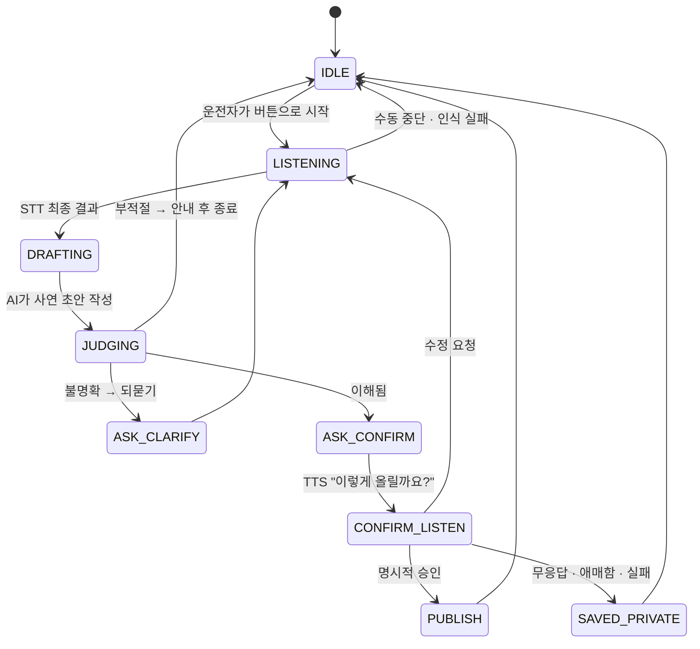

# ourroad · 같은 길, 다른 시간

서로 다른 시간에 같은 도로를 지나간 운전자들이, 말로 남긴 이야기로 이어지는 Pleos Connect 차량 앱.

> 현대자동차그룹 차량용 앱 개발 공모전 출품작 · 팀 UNSEEN

## 한 줄 소개

운전자가 라디오에 사연을 보내듯 말하면, 앱이 받아 적고 다듬어서 "이렇게 올릴까요?"라고 되묻습니다. 운전자가 "응"이라고 답해야만 그 길 위에 이야기가 남습니다.

## 주요 기능

| 기능 | 설명 | 상태 |
| --- | --- | --- |
| Prism Orb 홈 | 듣기·생각·말하기 상태를 빛으로 보여 주는 음성 중심 홈 화면 | 구현 (UI) |
| 길 위의 이야기 듣기 | 지금 지나는 구간에 남겨진 이야기를 음성으로 재생 | UI 목업 |
| 말로 남기는 사연 | Pleos STT로 받아 적고, AI가 정리하고, Pleos TTS로 확인한 뒤 게시 | [ ] 구현 중 |
| 판단 모델(Judge) | 정리본이 원래 말과 같은지, 개인정보가 없는지, 운전자가 확실히 승인했는지 판단해 다시 묻거나 비공개로 보관 | [ ] 구현 중 |
| 개인 길 기록 | 공개하지 않은 내 기록 보기 | UI 목업 |
| 주행 규제 대응 | 주행 규제 상태(CarUxRestrictions)에 따라 화면을 줄이고 음성 흐름만 유지 | [ ] 구현 중 |

## 시스템 구조



| 구성 | 하는 일 |
| --- | --- |
| 화면 | 주행 중에는 최소 정보만 보여 주고, 정차 중에는 이야기 목록·기록을 보여 줍니다 |
| 음성 대화 관리 | 듣기 → 정리 → 판단 → 되묻기 → 게시 흐름을 관리합니다. SDK 없이 테스트할 수 있게 순수 Kotlin으로 분리합니다 |
| 주행 규제 확인 | 규제 상태가 바뀌면 화면을 줄이고, 상태를 모르면 음성 세션을 멈춥니다 |
| Pleos SDK | 음성 인식·낭독·위치·차량 정보를 제공합니다 |
| 자체 서버 | STT 텍스트를 받아 사연으로 정리하고, 판단 모델이 결과를 구조화된 값(JSON)으로 돌려줍니다. API 키는 서버에만 둡니다 |

## 음성 사연 흐름



- 음성 인식은 **Pleos SpeechToText**로만 합니다. 차량 마이크 음성은 외부로 보내지 않고, 서버에는 STT가 만든 텍스트만 보냅니다.
- 무응답이나 애매한 대답은 승인으로 보지 않습니다. AI가 혼자 게시하지 않습니다.
- 시작·중단은 언제든 버튼으로도 할 수 있습니다. 내비게이션 안내나 통화가 오면 낭독을 멈췄다가 이어서 묻습니다.

계층별 설계 원칙: [docs/pleos/architecture.md](docs/pleos/architecture.md)

## 사용한 Pleos SDK

| SDK | 버전 | 용도 |
| --- | --- | --- |
| SpeechToText | 3.3.1 | 사연·확인 답변 음성 인식 (ON_DEVICE 모드) |
| TextToSpeech | 3.3.1 | 되묻기·확인·이야기 낭독 |
| Vehicle | [ ] | 주행 상태·차량 정보 |
| FusedLocation | 1.1.3 [ ] | 현재 구간 판별 |
| NaviHelper | [ ] 사용 여부 | |

LLM(정리·판단)은 Pleos LLM SDK가 제공되지 않아 자체 서버에서 외부 API로 처리합니다. 서버 소스와 API 키는 이 저장소에 포함하지 않습니다.

## 테스트 환경

| 항목 | 값 |
| --- | --- |
| 에뮬레이터 | **Pleos Connect v2.1.0** (Android 14 / API 34, Automotive) |
| 화면 규격 | **2560 × 1440, 160 dpi, 가로** |
| 빌드 | Android Studio (JBR 21), Gradle Wrapper 9.6.0, AGP 9.4.1 |
| SDK | compileSdk 37 · minSdk 28 · targetSdk 34 |
| 확인한 호스트 | macOS (Apple Silicon, arm64) [ ] Windows 확인 여부 |

## 실행 방법

### APK로 바로 실행

1. Pleos Connect v2.1.0 에뮬레이터를 켭니다.
2. 아래 명령으로 설치합니다.

```bash
adb install apk/UNSEEN_[앱이름]_release.apk
```

3. 앱 목록에서 **ourroad**를 실행합니다.

### 소스에서 빌드

```bash
./gradlew :app:assembleDebug
```

```bash
adb install -r app/build/outputs/apk/debug/app-debug.apk
```

`local.properties`에 `sdk.dir`(Android SDK 경로)이 있어야 합니다. Android Studio로 열면 자동으로 만들어집니다.

### 주행 규제 시연

에뮬레이터에서 주행 규제를 켜고 끄며 화면이 줄고 음성 흐름만 남는 것을 확인할 수 있습니다.

```bash
adb shell cmd hmg_car_service --service drivingstate driving_regulation on
```

```bash
adb shell cmd hmg_car_service --service drivingstate driving_regulation off
```

### 필요한 설정

- [ ] 서버 주소 설정 방법 (예: `local.properties`의 키 이름)
- [ ] 서버 없이 실행할 때 동작 (Fake 어댑터로 데모 가능한지)
- STT·TTS는 ON_DEVICE 모드라 별도 앱 등록(Client ID/Secret)이 필요 없습니다.

## APK 위치

`apk/UNSEEN_[앱이름]_release.apk` [ ] release 서명 빌드 후 추가

## 향후 계획

공식 문서에서 아직 확인되지 않은 아래 항목은 운영사무국·현대자동차 확인 결과에 맞춰 적용합니다.

- 주행 중 마이크 입력과 공개 전 음성 확인의 허용 범위
- 탑승 시 자동 시작 안내
- [ ] 팀 추가 항목

## 저장소 구성

| 경로 | 내용 |
| --- | --- |
| `app/` | Kotlin 차량 앱 (Prism Orb, 화면) |
| `apk/` | 제출용 release APK |
| `docs/` | 기획·Pleos 조사·주행 안전·검증 시나리오 |
| `docs/pleos/` | 아키텍처·요구사항·SDK 참고 |
| `intent.md` | 제품 기획 |

## 팀원용 안내

1. 이 저장소를 clone하고 [온보딩](docs/onboarding.md)을 따른다.
2. [제품 기획](intent.md), [프로젝트 맥락](docs/project-context.md), [결정·미정 사항](docs/decisions.md)을 확인한다.
3. [작업 목록](tasks/README.md)에서 담당 범위를 정하고 작업별 브랜치 → 검증 → PR → 다른 팀원 리뷰로 공유한다.

| 파일 | 역할 |
| --- | --- |
| [AGENTS.md](AGENTS.md) / [CLAUDE.md](CLAUDE.md) | AI 공통 규칙과 Claude Code 진입점 |
| [개발 환경](docs/environment.md) / [협업 흐름](docs/workflow.md) | OS별 시작과 작업 공유 |
| [Pleos 조사](docs/pleos.md) / [공모전 조사](docs/competition.md) | 조사 스냅샷; 사용 전 공식 원문 재확인 |
| [ourroad 검증 시나리오](docs/verification-scenarios.md) | 동의·차량 상태·공유 구간·프라이버시·콘텐츠 검증 |
| [작업 목록](tasks/README.md) / [양식](templates/README.md) / [프롬프트](PROMPTS.md) | 작업·API 계약·검증·인수인계 |
| [이관 기록](docs/harness-migration.md) / [검증 결과](docs/validation.md) | 원본 출처·폐기 기준·확인 수준 |

문서 검사(Python 3.9+, 외부 패키지 없음):

```sh
python3 scripts/check_harness.py
```

## ourroad · 다드리

앱 이름은 `ourroad`, 음성 에이전트는 `다드리`다. 차에서는 대화와 듣기만 하고, 보기·관리는 휴대폰 앱이 맡는다.

1차 기획 제출에서는 Pleos SDK 사용이 열리지 않으므로 차량 앱은 예시 대사와 시연 제어로 움직이는 목업이다. 앱을 실행한 뒤 오른쪽 "시연 제어"에서 **시나리오 1 · 혼자 퇴근, 정체 구간**을 누르면 다드리가 먼저 말을 걸고 사연 듣기 → 공감 → 사연 남기기 → 확인 후 게시까지 이어진다. 화면의 사연·발화는 모두 예시다. [음성 기획과 향후 SDK 사용 방안](docs/ourroad-voice.md), [작업 011](tasks/011-ourroad-voice.md).
